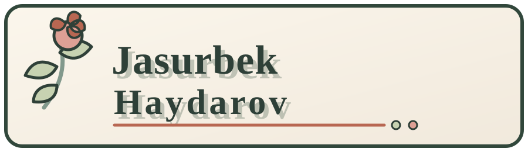
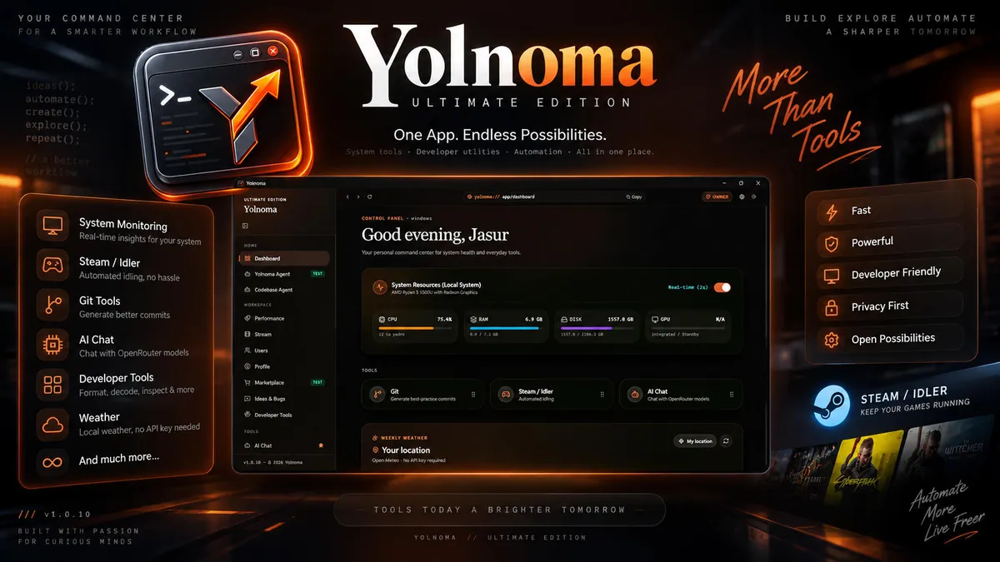
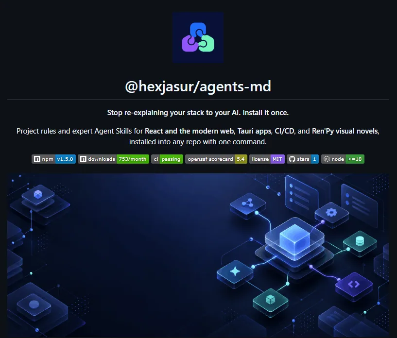
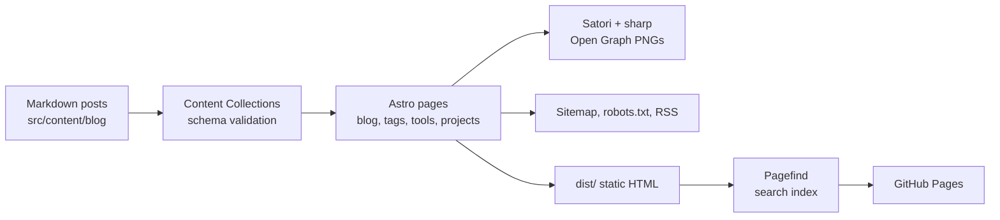

<div align="center">
  
  <br />
  <p><strong>Software Engineer · Builder · Technical Explorer</strong></p>
  <p>
    <a href="https://hexjasur.github.io/Jasurbek/">Live site</a>
    ·
    <a href="https://hexjasur.github.io/Jasurbek/blog/">Blog</a>
    ·
    <a href="https://hexjasur.github.io/Jasurbek/tools/">Tools</a>
    ·
    <a href="https://github.com/hexjasur">GitHub</a>
    ·
    <a href="https://t.me/jasurhaydarovcode">Telegram</a>
  </p>
  <p>
    <a href="https://github.com/hexjasur/Jasurbek/actions/workflows/deploy.yml"></a>
    <a href="https://github.com/hexjasur/Jasurbek/actions/workflows/ci.yml"></a>
    
    
    
    
  </p>
</div>

<div align="center">
  
</div>

## Overview

This repository is the source of **Jasurbek Haydarov's personal portfolio and technical blog**: a small, fast, static site for software projects, engineering notes, browser-based developer tools and tiny games.

The design pairs a warm editorial canvas with a botanical flora motif (cream surfaces, sage green, dusty rose, terracotta accents and deep-green borders). Floral assets are decorative layers, never content, so pages stay readable.

> Everything runs at build time. The shipped site is plain HTML and CSS with a very small amount of client-side JavaScript.

## Contents

- [Highlights](#highlights)
- [Latest articles](#latest-articles)
- [Featured projects](#featured-projects)
- [Tools and playground](#tools-and-playground)
- [Tech stack](#tech-stack)
- [How the site is built](#how-the-site-is-built)
- [Getting started](#getting-started)
- [Project structure](#project-structure)
- [Writing content](#writing-content)
- [Uzbek alphabet (2026 reform)](#uzbek-alphabet-2026-reform)
- [AI agent skills](#ai-agent-skills)
- [CI/CD and deployment](#cicd-and-deployment)
- [Configuration](#configuration)
- [License](#license)

## Highlights

| Area | What you get |
| --- | --- |
| **Profile** | Short biography, social links and a Formspree-powered contact form with optional Cloudflare Turnstile protection. |
| **Blog** | Markdown posts with reading time, table of contents, copy buttons on code blocks, older/newer navigation, tag pages, RSS and optional Giscus comments. |
| **Projects** | Selected work with repository links, live websites and real screenshots. |
| **Tools** | Privacy-first utilities that run entirely in the browser. |
| **Playground** | Small games and experiments in vanilla TypeScript. |
| **Search** | Full-text, in-browser search powered by Pagefind. Press `Ctrl` + `K` or `/` on any page. |
| **Dark mode** | Follows the system setting, with a manual toggle and no flash on load. |
| **SEO** | Canonical URLs, Open Graph and Twitter cards, JSON-LD (`Person`, `WebSite`, `BlogPosting`, `WebApplication`, breadcrumbs), sitemap, `robots.txt`. |
| **Social previews** | Branded 1200x630 Open Graph image for every page and post, generated at build time with Satori and sharp. |
| **Accessibility** | Skip link, visible focus ring, `aria-current` navigation, reduced-motion support, alt text on images. |

## Latest articles

| Date | Article | Language |
| --- | --- | --- |
| 2026-11-07 | [Anthropic Claude models 2026: Fable 5.1, Opus 5.5, Sonnet 5.5 and Haiku 5.5 — benchmarks, pricing and routing code](https://hexjasur.github.io/Jasurbek/blog/anthropic-claude-modellari-benchmark-2026/) | Uzbek |
| 2026-11-07 | [GTA 6: release date, price, pre-order and budget](https://hexjasur.github.io/Jasurbek/blog/gta-6-toliq-malumot/) | Uzbek |
| 2026-11-07 | [68 VS Code extensions I use](https://hexjasur.github.io/Jasurbek/blog/vscode-extensions-i-use/) | English |
| 2026-11-05 | [Maple for mathematics: algebra to calculus with worked examples](https://hexjasur.github.io/Jasurbek/blog/maple-math-basics-with-examples/) | Uzbek |
| 2026-11-04 | [Taxes in Uzbekistan 2026: VAT, profit tax, land tax and more](https://hexjasur.github.io/Jasurbek/blog/uzbekistan-soliq-qollanma/) | Uzbek |

Browse everything on the [blog index](https://hexjasur.github.io/Jasurbek/blog/) or subscribe through the [RSS feed](https://hexjasur.github.io/Jasurbek/rss.xml).

## Featured projects

<table>
  <tr>
    <td width="33%" align="center">
      <br />
      <strong><a href="https://github.com/hexjasur/numeric-methods">Numeric Methods</a></strong><br />
      Interactive numerical-methods lab for web, desktop and Android (Next.js, React, Tauri v2, Rust).
    </td>
    <td width="33%" align="center">
      <br />
      <strong><a href="https://github.com/hexjasur/Yolnoma-App">Yolnoma-App</a></strong><br />
      Tauri desktop workspace with developer utilities, network tools and local-first AI chat.
    </td>
    <td width="33%" align="center">
      <br />
      <strong><a href="https://github.com/hexjasur/AGENTS.md">AGENTS.md</a></strong><br />
      Open-source standard and CLI for reproducible instructions for AI coding agents.
    </td>
  </tr>
</table>

## Tools and playground

All tools run locally in your browser; nothing is uploaded.

| Tool | What it does |
| --- | --- |
| Uzbek Alphabet Converter | Convert between legacy Latin, the 2026 reformed Latin (Ö, Ğ, Ç, Ş) and Cyrillic. |
| JSON to TypeScript | Generate typed interfaces from raw JSON, with nested type resolution. |
| UUID and NanoID Generator | Cryptographically secure v4 UUIDs and URL-safe NanoIDs via WebCrypto. |
| Code and Data Minifier | Minify or beautify JSON, CSS and JavaScript with size-savings metrics. |
| WCAG Contrast Checker | Contrast ratios against WCAG 2.2 AA and AAA. |
| CSS `clamp()` Generator | Accessible, rem-based fluid typography and spacing values. |
| Base64 and URL Encoder | Base64, Base64URL and percent-encoding with full UTF-8 support. |
| Credit-Module Calculator | HEMIS / ECTS academic-debt and credit-cost calculator for Uzbek university students. |

**Playground:** Snake (under 200 lines of vanilla TypeScript) and a Reaction Time test.

## Tech stack

| Layer | Technology |
| --- | --- |
| Framework | [Astro 5](https://astro.build/) |
| Styling | [Tailwind CSS 4](https://tailwindcss.com/) and custom CSS |
| Content | Astro Content Collections with Markdown |
| Search | [Pagefind](https://pagefind.app/) (static, runs in the browser) |
| Open Graph images | [Satori](https://github.com/vercel/satori) and [sharp](https://sharp.pixelplumbing.com/) at build time |
| Comments | [Giscus](https://giscus.app/) (GitHub Discussions) |
| Navigation | Astro Client Router and view transitions |
| Deployment | GitHub Pages via GitHub Actions |
| Package manager | Bun (pnpm also works) |

## How the site is built



Frontmatter is validated against the schema in `src/content.config.ts` during `astro build`, so a malformed post fails the build instead of reaching production.

## Getting started

Requirements: [Bun](https://bun.sh/) (or pnpm) and a recent Node.js runtime.

```bash
bun install        # install dependencies
bun run dev        # dev server on http://localhost:4321
bun run check      # astro check (type-check)
bun run build      # production build + Pagefind index
bun run preview    # preview the build (search only works here)
```

| Script | Purpose |
| --- | --- |
| `dev` / `dev:host` | Development server (`dev:host` exposes it on the local network). |
| `check` | Type-check Astro and TypeScript files. |
| `build` | `astro build` followed by `pagefind --site dist`. |
| `preview` | Serve the production build locally. Search works here, not in `dev`. |

## Project structure

```text
src/
├── components/       # Header, footer, SEO head, search dialog, TOC, comments
├── content/blog/     # Markdown articles
├── data/             # Tools and playground lists (single source of truth)
├── lib/              # Blog helpers, JSON-LD, Open Graph rendering, URL helpers
├── layouts/          # Shared page shell and contact modal
├── pages/            # Profile, projects, blog, tools, playground, OG, RSS routes
└── styles/           # Global flora theme, dark mode and responsive styles
public/
├── images/flora/     # Botanical decorative assets
├── images/projects/  # Project screenshots
└── images/           # Profile and brand visuals
.claude/skills/       # Agent skills (see "AI agent skills")
.github/workflows/    # CI and GitHub Pages deployment
```

### Design tokens

| Token | Value | Role |
| --- | --- | --- |
| Warm canvas | `#F1E9DC` | Page background |
| Paper | `#FBF6EC` | Card and surface |
| Sage | `#C7D2B1` | Primary |
| Dusty rose | `#DDA095` | Accent |
| Terracotta | `#B86752` | Accent |
| Deep green ink | `#2F4038` | Text and borders |

Reuse the theme tokens from `src/styles/global.css` instead of introducing new colors.

## Writing content

**Blog post:** add `src/content/blog/<ascii-slug>.md`:

```yaml
---
title: "..."
description: "..."
pubDate: 2026-11-07
updatedDate: 2026-11-08   # optional, only when a published post is meaningfully revised
tags: ["ascii-tag", "another-tag"]
---
```

- Start body sections at `##`; the page title is the `h1`. Use `###` for subsections so the table of contents works.
- Its page, Open Graph image, RSS entry, sitemap entry, tag pages and search entry are generated automatically.
- New post: `pubDate` is the day you create it. Revision: set `updatedDate` and leave `pubDate` unchanged.
- Factual posts cite their sources with links, state an "as of" date and label the author's own calculations.
- Internal links include the base path, for example `/Jasurbek/tools/uzbek-alphabet`.

**Tool or playground demo:** add the page under `src/pages/tools/` or `src/pages/playground/` and register it in `src/data/tools.ts` or `src/data/playground.ts`.

## Uzbek alphabet (2026 reform)

Uzbek text in this project uses the reformed Latin alphabet finalized on **October 21, 2026**:

| Legacy (1995) | Reformed |
| --- | --- |
| Oʻ oʻ | Ö ö |
| Gʻ gʻ | Ğ ğ |
| Sh sh | Ş ş |
| Ch ch | Ç ç |

The tutuq belgisi (`ma'lumot`, `e'lon`) is unchanged, and blog tags stay ASCII. Convert old text with the in-site [Uzbek Alphabet Converter](https://hexjasur.github.io/Jasurbek/tools/uzbek-alphabet/), then review by hand. Details are in [`AGENTS.md`](./AGENTS.md) and the post [Uzbek Alphabet 2026 Reform](https://hexjasur.github.io/Jasurbek/blog/uzbek-alphabet-2026/).

## AI agent skills

Instructions for AI coding agents live in [`AGENTS.md`](./AGENTS.md). Reusable skills live in `.claude/skills/`.

| Skill | Purpose |
| --- | --- |
| [`anthropic-models-uz`](./.claude/skills/anthropic-models-uz/SKILL.md) | Write or refresh Uzbek articles about Anthropic's Claude models: verify facts against official sources, read benchmarks correctly, follow the 2026 alphabet and the date rules, and ship runnable code examples. |

The skill bundles a dated fact sheet ([`references/`](./.claude/skills/anthropic-models-uz/references/lineup-2026-11-07.md)) and an alphabet checker:

```bash
node .claude/skills/anthropic-models-uz/scripts/check-uz-alphabet.mjs src/content/blog/<slug>.md
```

The checker flags leftover legacy spelling, stray apostrophes and Cyrillic letters mixed into Latin words. English technical terms can show up as false positives, so review each hit.

## CI/CD and deployment

| Workflow | Trigger | What it does |
| --- | --- | --- |
| [`ci.yml`](./.github/workflows/ci.yml) | Every push to a branch other than `master`, and pull requests | Installs with a frozen lockfile, runs `astro check`, then the full build with the Pagefind index. |
| [`deploy.yml`](./.github/workflows/deploy.yml) | Push to `master` or manual dispatch | Builds the site and publishes `dist/` to GitHub Pages. |

Run `bun run check && bun run build` before opening a pull request. Do not commit `dist/`, `node_modules/` or `.astro/`.

## Configuration

Everything site-wide (domain, author, social links, SEO defaults) lives in `src/config.ts`.
When a custom domain is connected, update `siteUrl` and `domain` there and remove `base` from `astro.config.mjs`.

<details>
<summary><strong>Enable comments (Giscus)</strong></summary>

Comments stay hidden until a Giscus category id is set:

1. Enable **Discussions** in the repository settings.
2. Install the [Giscus app](https://github.com/apps/giscus) on the repository.
3. Open [giscus.app](https://giscus.app), choose the repository and category, and copy the generated `data-category-id`.
4. Paste it into `comments.categoryId` in `src/config.ts`.

</details>

<details>
<summary><strong>Enable the contact form (Formspree and Turnstile)</strong></summary>

1. Create a form at [Formspree](https://formspree.io/) and copy its form ID.
2. Set `formspreeFormId` in `src/config.ts` to that ID.
3. The contact form at `/contact/` then submits directly to Formspree.

To protect the form with Cloudflare Turnstile:

1. Create a Turnstile widget for your site's domain in the [Cloudflare dashboard](https://dash.cloudflare.com/).
2. Enable CAPTCHA in the Formspree form settings, select Cloudflare Turnstile and enter the Turnstile **secret key** there.
3. Set the Turnstile **site key** as `turnstileSiteKey` in `src/config.ts`. Keep the secret key in Formspree and never add it to the site code.

</details>

The portrait and decorative assets are kept local, so the static site stays self-contained and deploys directly to GitHub Pages.

## License

MIT © [Jasurbek Haydarov](https://github.com/hexjasur)
