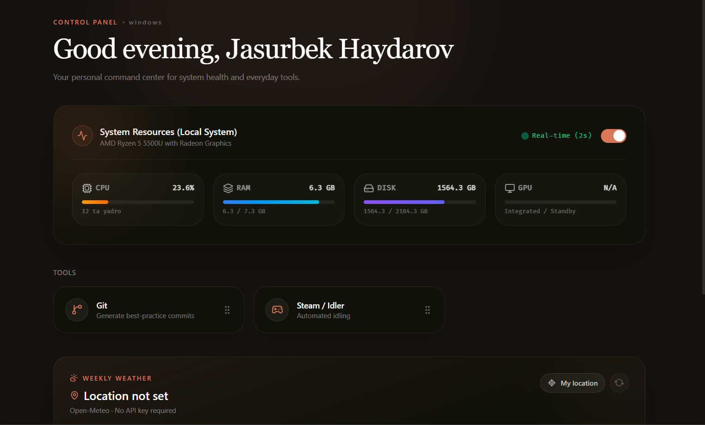
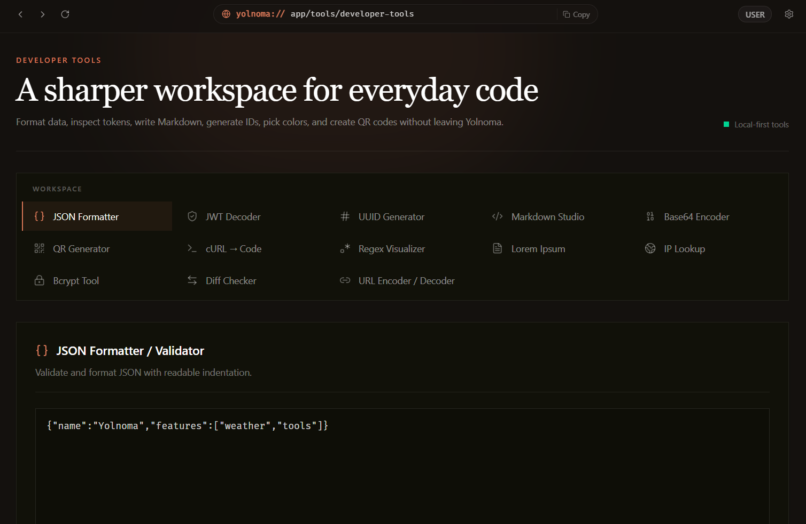
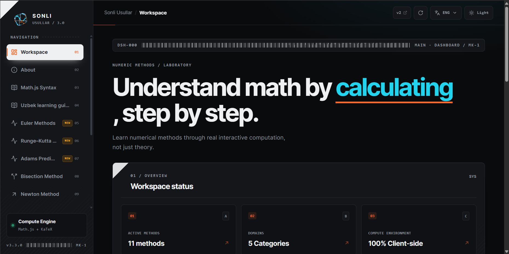

<div align="center">
  
  <br />
  <p><strong>Software Engineer · Builder · Technical Explorer</strong></p>
  <p>
    <a href="https://hexjasur.github.io/Jasurbek/">Portfolio</a>
    ·
    <a href="https://github.com/hexjasur">GitHub</a>
    ·
    <a href="https://t.me/jasurhaydarovcode">Telegram</a>
  </p>
</div>

<div align="center">
  
</div>

## About this repository

This repository contains **Jasurbek Haydarov's personal portfolio and technical blog**. It is a small, fast, static site for sharing software projects, experiments, engineering notes, and browser-based developer tools.

The visual direction combines a warm editorial canvas with a botanical flora motif: cream surfaces, sage green, dusty rose, terracotta accents, and sturdy dark-green borders. The floral assets are used as lightweight decorative layers rather than as content, keeping the pages readable and focused.

## What is inside

- **Profile** — a short biography, social links, and contact access.
- **Projects** — selected work with repository links, live websites, and real project screenshots.
- **Blog** — technical notes about software engineering, tooling, AI-assisted workflows, and practical experiments.
- **Tools** — privacy-first browser utilities for JSON, TypeScript, UUIDs, minification, and Uzbek alphabet conversion.

## Selected projects

### Yolnoma-App

A Tauri-powered desktop workspace that gathers developer, network, media, image, AI, and gaming utilities in one native application.

- React, TypeScript, Vite, Tailwind CSS
- Tauri v2 and Rust
- Local-first application data
- Live website: [app.yolnoma.uz](https://app.yolnoma.uz)
- Repository: [hexjasur/Yolnoma-App](https://github.com/hexjasur/Yolnoma-App)

<div align="center">
  
  
</div>

### Numeric Methods

An interactive laboratory for numerical methods and computational mathematics. It explains algorithms step by step with formulas, charts, audit tables, and export options.

- Next.js 16, React 19, Tailwind CSS 4
- Tauri v2 builds for web, Windows, Linux, and Android
- Bisection, Newton, interpolation, quadrature, and ODE solvers
- Live website: [sonli-usullar.uz](https://sonli-usullar.uz)
- Repository: [hexjasur/numeric-methods](https://github.com/hexjasur/numeric-methods)

<div align="center">
  
  
</div>

### AGENTS.md

A documentation project for installing and maintaining `AGENTS.md` instructions used by AI coding agents. It focuses on repeatable conventions, repository context, and consistent AI-assisted engineering workflows.

- Repository: [hexjasur/AGENTS.md](https://github.com/hexjasur/AGENTS.md)

<div align="center">
  
</div>

## Built with

| Layer | Technology |
| --- | --- |
| Framework | [Astro 5](https://astro.build/) |
| Styling | [Tailwind CSS 4](https://tailwindcss.com/) and custom CSS |
| Content | Astro Content Collections with Markdown |
| Navigation | Astro Client Router and view transitions |
| Deployment | GitHub Pages via GitHub Actions |
| Package manager | Bun or pnpm |

## Run locally

```bash
# Install dependencies
bun install

# Start the development server
bun run dev

# Create a production build
bun run build
```

The development site is available at `http://localhost:4321`.

## Repository map

```text
src/
├── components/       # Header and footer
├── content/blog/     # Markdown articles
├── layouts/          # Shared page shell and contact modal
├── pages/            # Profile, projects, blog, and tools routes
└── styles/           # Global flora theme and responsive styles
public/
├── images/flora/     # Botanical decorative assets
├── images/projects/  # Project screenshots
└── images/           # Profile and brand visuals
```

## Design notes

The site uses the following core flora palette:

- `#F1E9DC` — warm canvas
- `#FBF6EC` — paper-like surface
- `#C7D2B1` — sage primary
- `#DDA095` — dusty rose accent
- `#B86752` — terracotta accent
- `#2F4038` — deep green ink

The portfolio portrait and decorative assets are kept local so the static site remains self-contained and can be deployed directly to GitHub Pages.

## License

MIT © [Jasurbek Haydarov](https://github.com/hexjasur)
