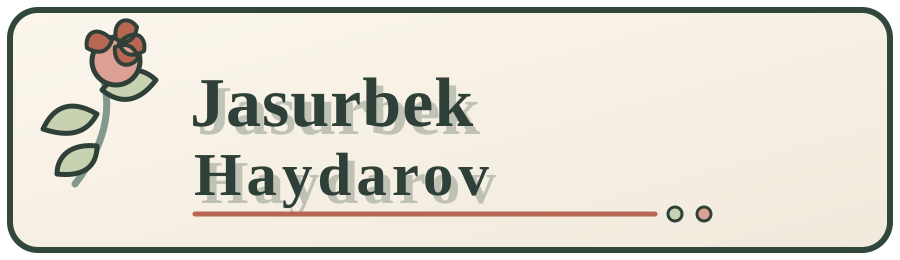
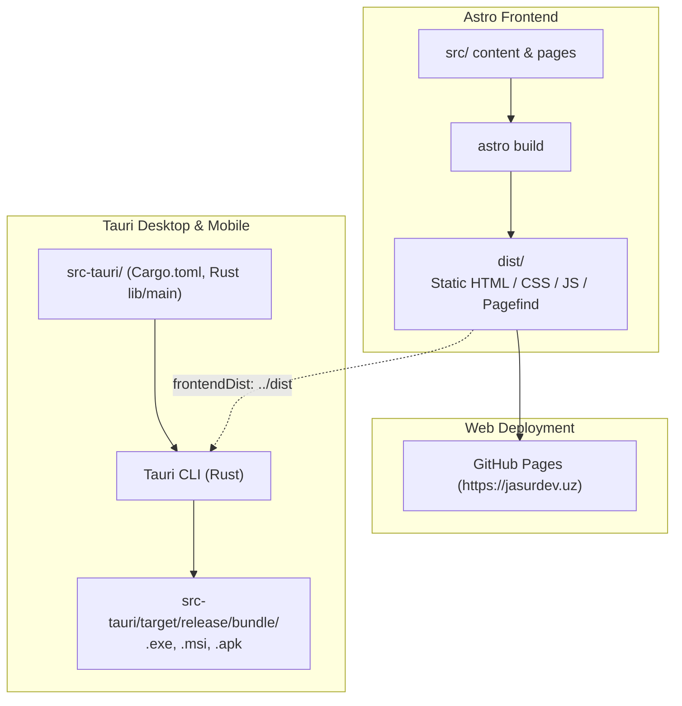

<div align="center">
  
  <br />
  <p><strong>Software Engineer · Builder · Technical Explorer</strong></p>
  <p>
    <a href="https://jasurdev.uz/">Live site</a>
    ·
    <a href="https://jasurdev.uz/blog/">Blog</a>
    ·
    <a href="https://jasurdev.uz/tools/">Tools</a>
    ·
    <a href="https://jasurdev.uz/projects/">Projects</a>
    ·
    <a href="https://github.com/hexjasur">GitHub</a>
    ·
    <a href="https://t.me/jasurhaydarovcode">Telegram</a>
  </p>
  <p>
    <a href="https://github.com/hexjasur/Jasurbek/actions/workflows/deploy.yml"></a>
    <a href="https://github.com/hexjasur/Jasurbek/actions/workflows/ci.yml"></a>
    
    
    
    
    
    
  </p>
</div>

<div align="center">
  
</div>

## Overview

This repository is the source of **Jasurbek Haydarov's personal portfolio, technical blog, and native cross-platform application**: a static site for software projects, engineering notes, browser-based developer tools, and small games, packaged natively for desktop and mobile with **Tauri v2**.

The design pairs a warm editorial canvas with a botanical flora motif (cream surfaces, sage green, dusty rose, terracotta accents and deep-green borders). Floral assets are decorative layers, never content, so pages stay readable.

> Everything runs at build time. The shipped web site is plain HTML and CSS with a very small JavaScript footprint, and the desktop app runs via lightweight native WebView without Electron bloat.

## Contents

- [Highlights](#highlights)
- [Tech stack](#tech-stack)
- [How the project is built](#how-the-project-is-built)
- [Build outputs & directory separation](#build-outputs--directory-separation)
- [Getting started](#getting-started)
- [Project structure](#project-structure)
- [Writing content](#writing-content)
- [Uzbek alphabet (2026 reform)](#uzbek-alphabet-2026-reform)
- [Commit standards (commitlint & husky)](#commit-standards-commitlint--husky)
- [AI agent skills](#ai-agent-skills)
- [CI/CD and deployment](#cicd-and-deployment)
- [Configuration](#configuration)
- [License](#license)

## Highlights

| Area | What you get |
| --- | --- |
| **Profile** | Short biography, social links and a Formspree-powered contact form with optional Cloudflare Turnstile protection. |
| **Blog** | Markdown posts with reading time, table of contents, copy buttons on code blocks, older/newer navigation, tag pages, RSS and optional Giscus comments. |
| **Projects** | Selected work with repository links, live websites, case studies, and real screenshots. |
| **Tools** | Privacy-first utilities that run locally in the browser with strict third-party non-liability disclaimers. |
| **Playground** | Small games and experiments in vanilla TypeScript. |
| **Desktop & Mobile App** | Packaged cross-platform desktop (`.exe`, `.msi`) and mobile (`.apk`) apps using Tauri v2 and Rust. |
| **Search** | Full-text, in-browser search powered by Pagefind. Press `Ctrl` + `K` or `/` on any page. |
| **Dark mode** | Follows the system setting, with a manual toggle and no flash on load. |
| **SEO** | Canonical URLs, Open Graph and Twitter cards, JSON-LD (`Person`, `WebSite`, `BlogPosting`, `WebApplication`, breadcrumbs), sitemap, `robots.txt`. |
| **Social previews** | Branded 1200x630 Open Graph image for every page, post, tool, and project, generated at build time with Satori and sharp. |
| **Accessibility** | Skip link, visible focus ring, `aria-current` navigation, reduced-motion support, alt text on images. |

## Tech stack

| Layer | Technology |
| --- | --- |
| Web framework | [Astro 5](https://astro.build/) |
| Styling | [Tailwind CSS 4](https://tailwindcss.com/) and custom CSS |
| Native shell | [Tauri v2](https://v2.tauri.app/) (Rust 2024 edition) |
| Content | Astro Content Collections with Markdown |
| Search | [Pagefind](https://pagefind.app/) (static, runs in the browser) |
| Open Graph images | [Satori](https://github.com/vercel/satori) and [sharp](https://sharp.pixelplumbing.com/) at build time |
| Comments | [Giscus](https://giscus.app/) (GitHub Discussions) |
| Navigation | Astro Client Router and view transitions |
| Git hooks & linting | [Husky](https://typicode.github.io/husky/) + [Commitlint](https://commitlint.js.org/) (Conventional Commits) |
| Deployment | GitHub Pages via GitHub Actions |
| Package manager | Bun (pnpm also works) |

## How the project is built



Frontmatter is validated against the schema in `src/content.config.ts` during `astro build`, so a malformed post fails the build instead of reaching production.

## Build outputs & directory separation

To keep the development workflow organized and prevent collisions between the web deployment and native applications, the build directories are strictly segregated:

| Directory | Generator | Contents & Purpose | Tracked by Git? |
| --- | --- | --- | --- |
| **`dist/`** | Astro (`bun run build`) | Static website assets (HTML, CSS, JS, `pagefind/`, and XML feeds). Deployed directly to GitHub Pages. Tauri uses this directory as its frontend source (`frontendDist: "../dist"`). | **No** (in `.gitignore`) |
| **`src-tauri/target/`** | Cargo / Tauri (`bun run tb`) | Native compiled binaries (`.exe`, `.msi`, `.apk`) and Rust compilation artifacts. | **No** (in `.gitignore`) |
| **`src-tauri/`** | Tauri Core | Rust project files (`Cargo.toml`, `src/lib.rs`, `src/main.rs`), app icons, capabilities, and `tauri.conf.json`. | **Yes** (source code) |

> [!NOTE]
> Vite's file watcher explicitly ignores `**/src-tauri/**` in `astro.config.mjs`. This prevents `EBUSY: resource busy or locked` errors on Windows when Rust compiles binaries inside `src-tauri/target/`.

## Getting started

Requirements:
- [Bun](https://bun.sh/) (or pnpm / Node.js 18+)
- [Rust & Cargo](https://rustup.rs/) (1.90+ for Tauri v2 native builds)
- Windows C++ Build Tools (for Windows `.exe` builds)

```bash
bun install        # install dependencies
```

### Web development commands

| Command | Purpose | Port |
| --- | --- | --- |
| `bun run dev` | Start the Astro development server. | `http://localhost:4321` |
| `bun run dev:host` | Expose the dev server across the local network. | `http://0.0.0.0:4321` |
| `bun run check` | Run `astro check` to validate types and content. | — |
| `bun run build` | Full production build (`astro build` + `pagefind --site dist`). | Generates `dist/` |
| `bun run preview` | Preview production build locally (Pagefind search works here). | `http://localhost:4321` |

### Tauri desktop & mobile commands

Tauri runs on a dedicated port (`1420`) via `dev:tauri` so it never conflicts with an active web development session on port `4321`:

| Command | Purpose | Details |
| --- | --- | --- |
| `bun run td` | Run the Tauri desktop app in dev mode. | Spawns Astro on `http://localhost:1420` + native window. |
| `bun run tb` | Build production desktop installer (`.exe` / `.msi`). | Outputs to `src-tauri/target/release/bundle/`. |
| `bun run td:safe` | **RAM/CPU safe dev:** Compiles with a single Rust job. | Uses `cross-env CARGO_BUILD_JOBS=1`. |
| `bun run tb:safe` | **RAM/CPU safe build:** Prevents CPU/RAM exhaustion. | Uses `cross-env CARGO_BUILD_JOBS=1`. |
| `bun run android:init` | Initialize Android target project. | Creates `src-tauri/gen/android` (requires Android Studio / JDK). |
| `bun run android:dev` | Run app on connected Android device or emulator. | — |
| `bun run android:build` | Build release `.apk` / `.aab` package for Android. | — |

## Project structure

```text
src/
├── components/       # Header, footer, SEO head, search dialog, TOC, comments
├── content/blog/     # Markdown articles
├── data/             # Projects, tools, and playground lists (single source of truth)
├── lib/              # Blog helpers, JSON-LD, Open Graph rendering, URL helpers
├── layouts/          # Shared page shell and contact modal
├── pages/            # Profile, projects, blog, tools, playground, OG, RSS routes
└── styles/           # Global flora theme, dark mode and responsive styles
src-tauri/
├── capabilities/     # Tauri v2 security capabilities
├── icons/            # App icons (desktop, iOS, Android)
├── src/              # Rust source (lib.rs entrypoint, main.rs)
├── Cargo.toml        # Rust dependencies and package manifest
└── tauri.conf.json   # Tauri v2 configuration (window size, identifier, bundle)
public/
├── images/flora/     # Botanical decorative assets
├── images/projects/  # Project screenshots and banners
└── images/           # Profile and brand visuals
.husky/               # Git hook for Conventional Commits
.claude/skills/       # Agent skills (see "AI agent skills")
.github/workflows/    # CI and GitHub Pages deployment
```

### Design tokens

| Token | Value | Role |
| --- | --- | --- |
| Warm canvas | `#F1E9DC` | Page background |
| Paper | `#FBF6EC` | Card and surface |
| Sage | `#C7D2B1` | Primary |
| Dusty rose | `#DDA095` | Accent |
| Terracotta | `#B86752` | Accent |
| Deep green ink | `#2F4038` | Text and borders |

Reuse the theme tokens from `src/styles/global.css` instead of introducing new colors.

## Writing content

**Blog post:** add `src/content/blog/<ascii-slug>.md`:

```yaml
---
title: "..."
description: "..."
pubDate: 2026-11-15
updatedDate: 2026-11-15   # optional, only when a published post is meaningfully revised
tags: ["ascii-tag", "another-tag"]
---
```

- Start body sections at `##`; the page title is the `h1`. Use `###` for subsections so the table of contents works.
- Its page, Open Graph image, RSS entry, sitemap entry, tag pages and search entry are generated automatically.
- New post: `pubDate` is the day you create it. Revision: set `updatedDate` to the current revision date.
- Factual posts cite their sources with links, state an "as of" date and label calculations.

**Projects:** register new projects in `src/data/projects.ts`. Individual project pages (`/projects/<slug>`) and OG preview cards (`/og/projects/<slug>.png`) are generated automatically.

**Tools & playground:** add the page under `src/pages/tools/` or `src/pages/playground/` and register it in `src/data/tools.ts` or `src/data/playground.ts`.

## Uzbek alphabet (2026 reform)

Uzbek text in this project uses the reformed Latin alphabet finalized on **October 21, 2026**:

| Legacy (1995) | Reformed |
| --- | --- |
| Oʻ oʻ | **Ö ö** |
| Gʻ gʻ | **Ğ ğ** |
| Sh sh | **Ş ş** |
| Ch ch | **Ç ç** |

The tutuq belgisi (`ma'lumot`, `e'lon`) is unchanged, and blog tags stay ASCII. Convert legacy text with the in-site [Uzbek Alphabet Converter](https://jasurdev.uz/tools/uzbek-alphabet/), then review by hand. Details are in [`AGENTS.md`](./AGENTS.md) and the post [Uzbek Alphabet 2026 Reform](https://jasurdev.uz/blog/uzbek-alphabet-2026/).

## Commit standards (commitlint & husky)

This project enforces [Conventional Commits](https://www.conventionalcommits.org/) via **commitlint** and a **Husky** `commit-msg` hook:

```text
feat: add new feature
fix: resolve an issue
docs: update documentation
refactor: improve code structure without changing behavior
chore: maintenance and dependency updates
```

The hook automatically validates all commit messages before they are recorded:

```bash
bunx --bun commitlint --edit "$1"
```

## AI agent skills

Instructions for AI coding agents live in [`AGENTS.md`](./AGENTS.md). Reusable skills live in `.claude/skills/`.

| Skill | Purpose |
| --- | --- |
| [`anthropic-models-uz`](./.claude/skills/anthropic-models-uz/SKILL.md) | Write or refresh Uzbek articles about Anthropic's Claude models: verify facts against official sources, read benchmarks correctly, follow the 2026 alphabet and date rules, and ship runnable code examples. |

The skill bundles a dated fact sheet and an alphabet checker:

```bash
node .claude/skills/anthropic-models-uz/scripts/check-uz-alphabet.mjs src/content/blog/<slug>.md
```

## CI/CD and deployment

| Workflow | Trigger | What it does |
| --- | --- | --- |
| [`ci.yml`](./.github/workflows/ci.yml) | Every push to a branch other than `master`, and pull requests | Installs with a frozen lockfile, runs `astro check`, then the full build with the Pagefind index. |
| [`deploy.yml`](./.github/workflows/deploy.yml) | Push to `master` or manual dispatch | Builds the site and publishes `dist/` to GitHub Pages. |

Run `bun run check && bun run build` before opening a pull request. Do not commit `dist/`, `node_modules/` or `.astro/`.

## Configuration

Everything site-wide (domain, author, social links, SEO defaults) lives in `src/config.ts`.
When a custom domain is connected, update `siteUrl` and `domain` there and remove `base` from `astro.config.mjs`.

<details>
<summary><strong>Enable comments (Giscus)</strong></summary>

Comments stay hidden until a Giscus category id is set:

1. Enable **Discussions** in the repository settings.
2. Install the [Giscus app](https://github.com/apps/giscus) on the repository.
3. Open [giscus.app](https://giscus.app), choose the repository and category, and copy the generated `data-category-id`.
4. Paste it into `comments.categoryId` in `src/config.ts`.

</details>

<details>
<summary><strong>Enable the contact form (Formspree and Turnstile)</strong></summary>

1. Create a form at [Formspree](https://formspree.io/) and copy its form ID.
2. Set `formspreeFormId` in `src/config.ts` to that ID.
3. The contact form at `/contact/` then submits directly to Formspree.

To protect the form with Cloudflare Turnstile:

1. Create a Turnstile widget for your site's domain in the [Cloudflare dashboard](https://dash.cloudflare.com/).
2. Enable CAPTCHA in the Formspree form settings, select Cloudflare Turnstile and enter the Turnstile **secret key** there.
3. Set the Turnstile **site key** as `turnstileSiteKey` in `src/config.ts`. Keep the secret key in Formspree and never add it to the site code.

</details>

## License

MIT © [Jasurbek Haydarov](https://github.com/hexjasur)
